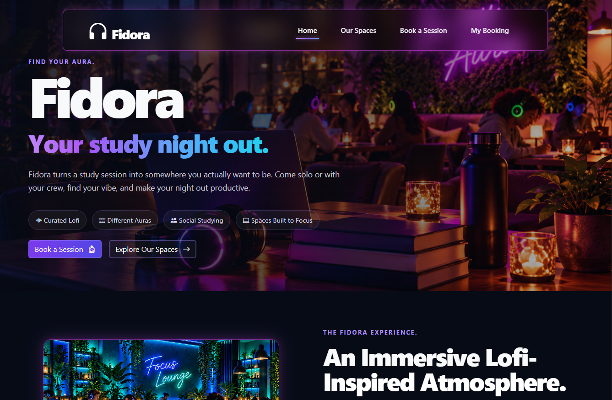
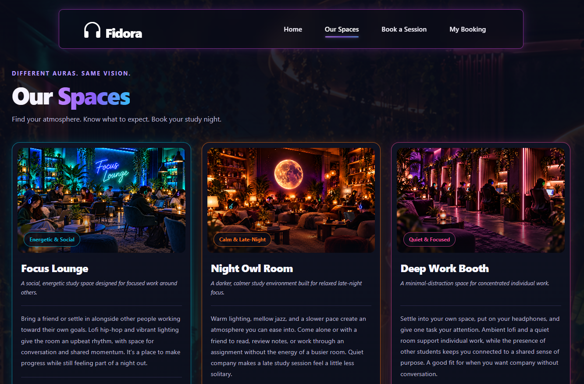
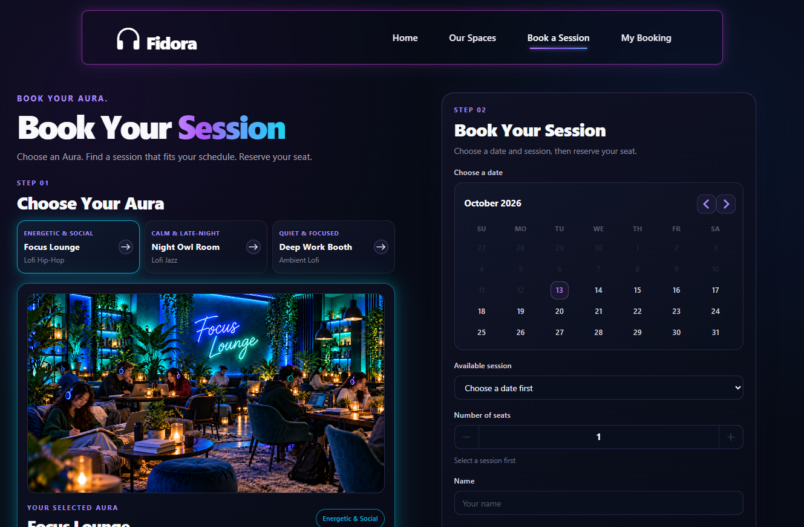
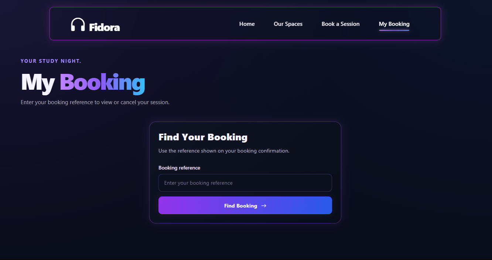
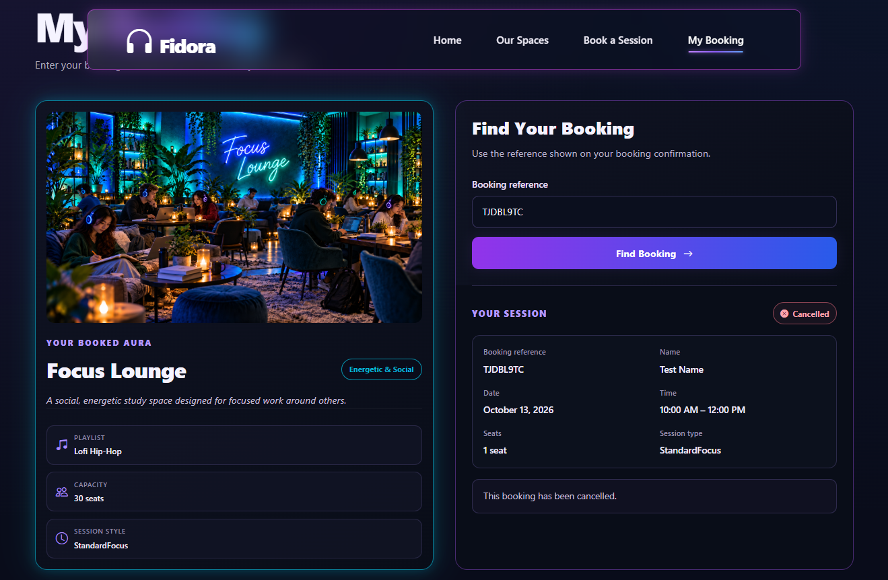
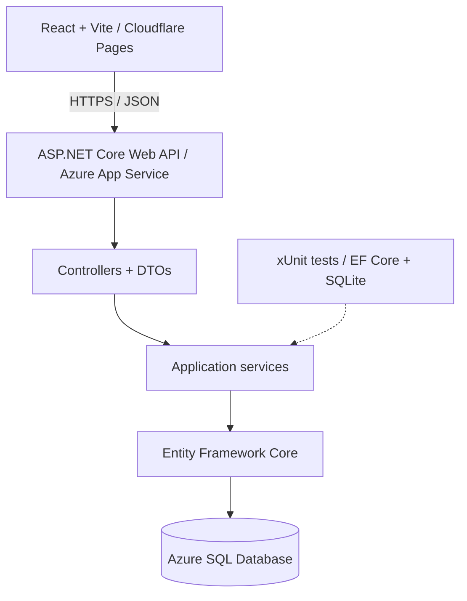

# Fidora — Study Lounge Booking Platform

**A full-stack booking platform for a fictional, modern, lo-fi-inspired study lounge.**

[**Live Demo**](https://fidora.pages.dev) · [**GitHub Repository**](https://github.com/rleenrwd/Fidora)

> **Project scope:** Fidora is an intentionally compact, end-to-end software engineering portfolio project—not an operating business or a real reservation service. Its spaces, sessions, and bookings are demonstration data. The goal was to design, implement, automatically test, and deploy a complete booking workflow without expanding the project into an unnecessarily large platform.


## Overview

*Your study night out.*

Fidora imagines a contemporary study lounge built around curated lo-fi music, silent-disco-style wireless headphones, and distinct room **auras**. Each room offers a unique atmosphere shaped by its lighting, visual design, seating arrangement, and musical style.

Every room has its own curated lo-fi playlist, streamed directly to students through wireless silent-disco headphones. This creates an immersive, shared-but-personal listening experience where students can study alongside others while enjoying music tailored to their chosen environment—from energetic lo-fi hip-hop to relaxed jazz and ambient deep-focus sounds.

The name **Fidora** combines **lo-fidelity** and **aura**, reflecting the lounge's focus on music-driven study environments.

This repository contains the **customer-facing booking application** for that fictional venue, not the music-streaming or headphone-management system. Visitors can explore spaces, find scheduled sessions, check seat availability, create a reservation, retrieve it using a booking reference, and cancel it.


## Screenshots

### Home


### Our Spaces


### Book a Session


### My Booking


### Booking Details


- **Home** — Fidora introduction and featured spaces
- **Our Spaces** — Room atmosphere, lo-fi style, and capacity
- **Book a Session** — Session selection, available seats, and booking form
- **Booking Confirmation** — Reservation details and reference
- **My Booking** — Reference-based lookup and cancellation

## Features

- **Three themed spaces:** Focus Lounge, Night Owl Room, and Deep Work Booth, each with a different study atmosphere.
- **Two session formats:** Standard Focus sessions for independent study, and **50/10 Focus** sessions with 50-minute work periods and optional 10-minute social breaks.
- **Session discovery:** Browse scheduled sessions and filter by space, date, or session type through the API.
- **Seat reservations:** Select a session, provide booking details, and reserve one or more seats.
- **Booking management:** Receive a unique reference, retrieve booking details, and cancel an existing reservation without creating an account.
- **Capacity updates:** Confirmed bookings reduce availability; cancellations release seats back to the session.
- **Responsive frontend:** React pages for Home, Our Spaces, Book a Session, and My Booking.

## Engineering Highlights

- **Intentionally lightweight modular monolith:** React frontend plus an ASP.NET Core API organized into controllers, DTOs, services, and data access—clear boundaries without unnecessary distributed infrastructure.
- **Server-side booking rules:** The API validates reservation requests, rejects unavailable or past sessions, and prevents repeated cancellation.
- **Transactional capacity enforcement:** Booking creation uses a **serializable database transaction** to guard against competing reservations exceeding seat availability.
- **Relational persistence:** Entity Framework Core models **Space → Session → Booking** relationships, migrations, indexes, constraints, and booking status persistence in SQL Server/Azure SQL.
- **Maintainable .NET patterns:** Dependency injection, asynchronous EF Core operations, LINQ, and request/response DTOs.
- **Automated backend verification:** **7 passing xUnit tests** exercise booking and availability behavior using **EF Core with in-memory SQLite**.
- **Independent cloud deployment:** React is hosted on Cloudflare Pages, the API on Azure App Service, and persistent application data in Azure SQL. GitHub integrations automate deployments.

## Technology Stack

| Area | Technology |
| --- | --- |
| Frontend | React, JavaScript, Vite, CSS |
| Backend | C#, ASP.NET Core Web API (.NET 10) |
| Data access | Entity Framework Core, LINQ |
| Database | SQL Server (development), Azure SQL Database (deployed) |
| Automated tests | xUnit, EF Core SQLite, Microsoft.NET.Test.Sdk |
| Frontend hosting | Cloudflare Pages |
| API hosting | Azure App Service (Linux) |
| CI/CD | Cloudflare Git integration; GitHub Actions for API deployment |

## Architecture



The API owns booking validation and capacity calculations. The frontend handles user interaction and displays results returned by the API. The database stores **Spaces**, **Sessions**, and **Bookings**, with one-to-many relationships between them. Azure App Service provides the deployed database connection configuration using managed identity authentication.

## API Endpoints

| Method | Route | Purpose |
| --- | --- | --- |
| `GET` | `/api/spaces` | List study spaces |
| `GET` | `/api/spaces/{id}` | Retrieve a space |
| `GET` | `/api/sessions` | List sessions; optionally filter by `spaceId`, `date`, or `sessionType` |
| `GET` | `/api/sessions/{id}` | Retrieve a session and availability |
| `POST` | `/api/bookings` | Create a reservation |
| `GET` | `/api/bookings/{bookingReference}` | Find a reservation |
| `POST` | `/api/bookings/{bookingReference}/cancel` | Cancel a reservation |

Booking creation accepts a session ID, customer name, email, and seat count. The API uses appropriate HTTP responses and validation for unsuccessful requests.

## Testing

**All 7 automated backend tests passed.** The test suite uses **xUnit** and isolated, in-memory **SQLite** databases via EF Core, allowing service behavior and persisted state to be checked without connecting to the deployed Azure SQL database.

| Test class | Tests | Verified behavior |
| --- | --- | --- |
| `BookingServiceTests` | 6 | Successful booking creation; insufficient-capacity rejection; cancellation; repeated-cancellation rejection; booking lookup; past-session rejection |
| `SessionServiceTests` | 1 | Remaining seats count confirmed bookings and exclude cancelled bookings |
| **Total** | **7 passed** | **Core reservation and availability rules** |

Run the automated backend suite from the repository root:

```bash
dotnet test backend/Fidora.Tests/Fidora.Tests.csproj
```

The deployed application was also manually tested end-to-end: listing spaces and sessions, creating a booking, retrieving it by reference, cancelling it, confirming the cancelled status persists, and verifying that its seats become available again. Direct navigation and refreshes across the React routes were also verified.

## Deployment

- **Frontend:** Cloudflare Pages builds and publishes the React/Vite application from the GitHub `main` branch.
- **Backend:** GitHub Actions builds and deploys the ASP.NET Core API to Azure App Service.
- **Database:** Azure SQL stores seeded fictional spaces and sessions plus demonstration bookings; EF Core migrations manage the schema.

The frontend uses `VITE_API_BASE_URL` for environment-specific API URLs. The API configures CORS for the hosted frontend. The production SQL connection is configured in App Service rather than embedded in the frontend.

## Run Locally

**Prerequisites:** .NET 10 SDK, Node.js/npm, and an accessible SQL Server instance.

1. Configure the API's local `ConnectionStrings:FidoraDatabase` setting for your SQL Server instance and apply the project's EF Core migrations to an empty database if needed.
2. From the repository root, start the API:

   ```bash
   dotnet run --project backend/Fidora.Api/Fidora.Api.csproj
   ```

3. Set `VITE_API_BASE_URL` in `frontend/Fidora.Client/.env` to the local API URL (for example, `http://localhost:5043`).
4. In another terminal, start the frontend:

   ```bash
   cd frontend/Fidora.Client
   npm install
   npm run dev
   ```

**Created by [Robert L. Norwood](https://github.com/rleenrwd)**